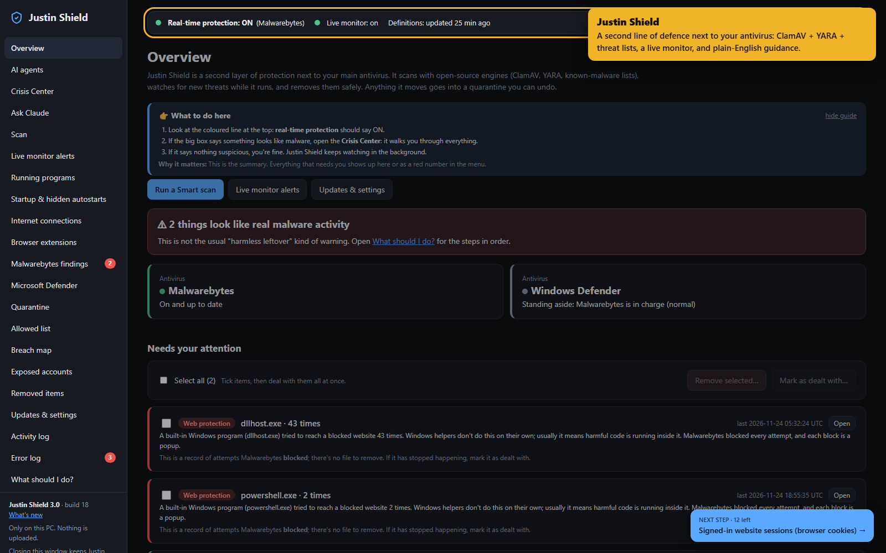
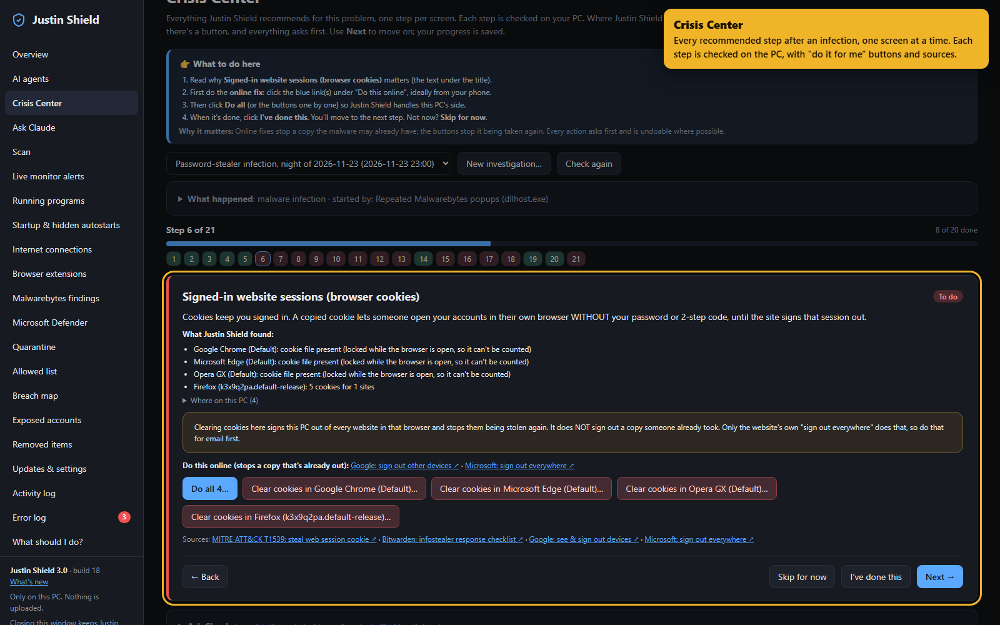
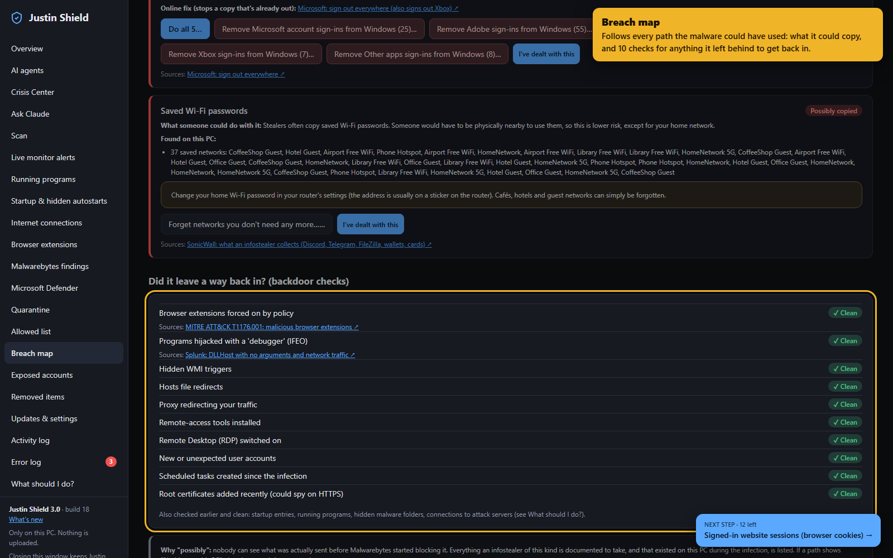
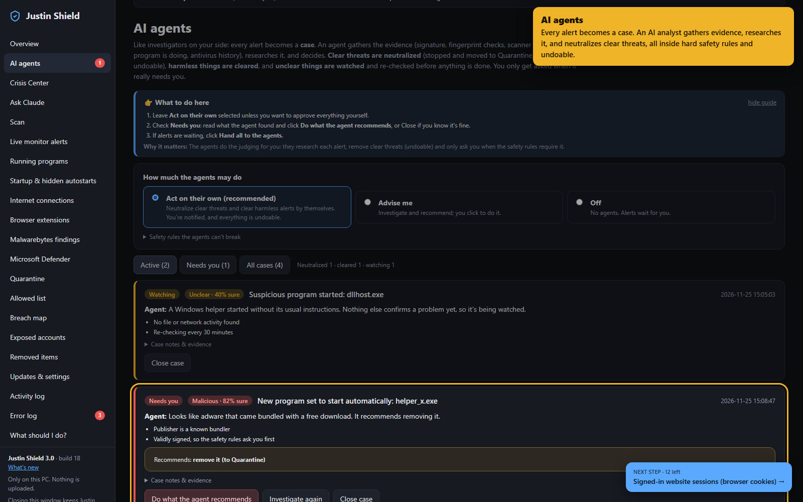
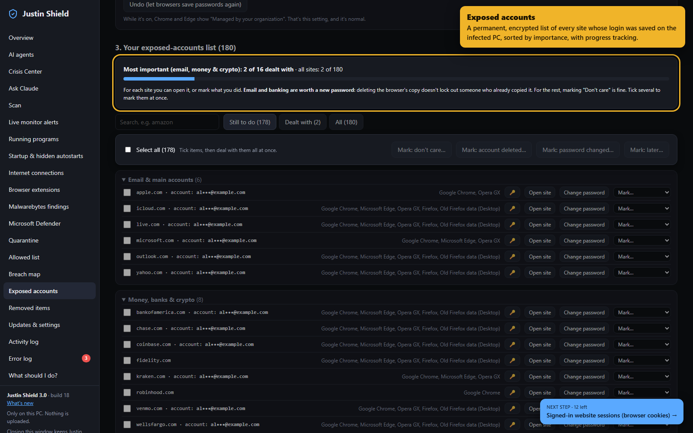

<h1 align="center">Justin Shield</h1>

<b>A clean-up and recovery tool for a Windows PC that may have been infected.</b> 
Works next to your normal antivirus, explains everything in plain English, and walks you through fixing it one step at a time. 
Nothing is removed or changed until you click.

<a href="../../releases/latest"><b>⬇ Download the latest version</b></a> · Windows 10 / 11 · free, <a href="https://ko-fi.com/justin55287">pay what you want ☕</a>

---

## What it does

| | |
|---|---|
| **Crisis Center** | Every recommended recovery step after an infection, one screen at a time, with a Next button so you don't get lost. Each step is checked on your PC, with "do it for me" buttons and the research behind it. |
| **AI agents** | Every alert becomes a case. An AI analyst gathers evidence and gives a verdict. It only acts alone on clear threats (scanner or threat-list detection, not validly signed), and everything it removes can be restored. |
| **Breach map** | Follows every path an info-stealer could use: saved passwords, cookies, cards, crypto wallets, app sign-ins, Wi-Fi keys. It runs 10 checks for anything left behind to get back in, and clears items by itself once you've dealt with them. |
| **Exposed accounts** | An encrypted list of every site whose login was saved on the PC, sorted by importance, with progress you can mark. It can clear saved browser passwords for you. |
| **Protects itself** | Admin-only lock, encrypted private data, and a tamper check. |
| **A receipt for everything** | Every removal and change is listed with a Restore button where possible. |
| **Scanners** | ClamAV, YARA rules and public threat lists, plus a live monitor. It can also read what Windows Defender and Malwarebytes already found. |

*Screenshots use made-up demo data.*

## Choose your AI helper

On first start you choose one (you can change it later):

- **Claude (best).** Explains findings, researches threats on the web, runs the AI agents. Needs [Claude Code](https://claude.com/claude-code) installed and signed in on your PC. The details of a finding are sent to Anthropic to be analysed.
- **Free AI on this PC.** Open source (Ollama + Qwen3), private, and works offline: nothing leaves your PC. It explains findings and judges alerts under stricter rules, but can't search the web. It's a one-click setup (about 5 GB download) and needs 8 GB of memory or more.
- **No AI.** Scanners, live monitor, guide and checklists only.

## How to install

1. Download `JustinShield-<version>.zip` from [Releases](../../releases/latest) and unzip it somewhere permanent, for example `C:\Justin Shield`.
2. Double-click **JustinShield.exe**.
3. **Windows will say "Windows protected your PC".** Justin Shield isn't code-signed yet, so Windows doesn't recognise it. Click **More info → Run anyway**. Each release links its VirusTotal scan so you can check the file first.
4. Click **Yes** when Windows asks for administrator rights. Justin Shield needs them to stop programs and quarantine files.
5. Read and agree to the terms, then pick your AI helper.

## What it can't do

- It's a **second line of defence, not a replacement** for Windows Security or your antivirus. Keep that on.
- Newer Chrome and Edge passwords are locked to the browser, so it can't always read them. That doesn't mean they weren't stolen.
- Secure delete on an SSD can't guarantee every old copy is gone.
- "Build what's missing" and automatic error fixing are only in the developer version, not in this download.

## Terms and price

- **Pay what you want, including $0.** If Justin Shield helped you, you can support it on **[Ko-fi ☕](https://ko-fi.com/justin55287)**. Payments are voluntary and **not refundable**. Paying doesn't unlock anything extra.
- Provided **as-is, with no warranty**. You must agree to the [terms](TERMS.txt) on first start. Governed by New York law.
- Uses open-source parts under their own licenses: see [THIRD-PARTY.txt](THIRD-PARTY.txt).
- Not affiliated with or endorsed by Microsoft, Malwarebytes, Anthropic, Ollama or Alibaba (Qwen). Product names are trademarks of their owners.
